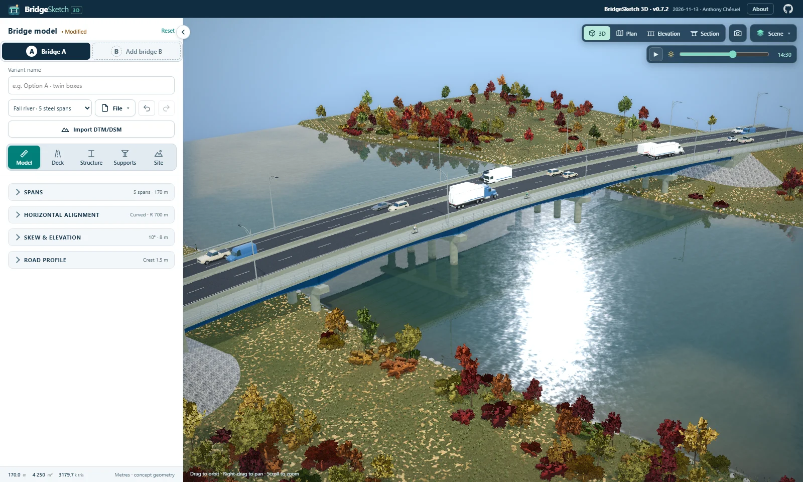
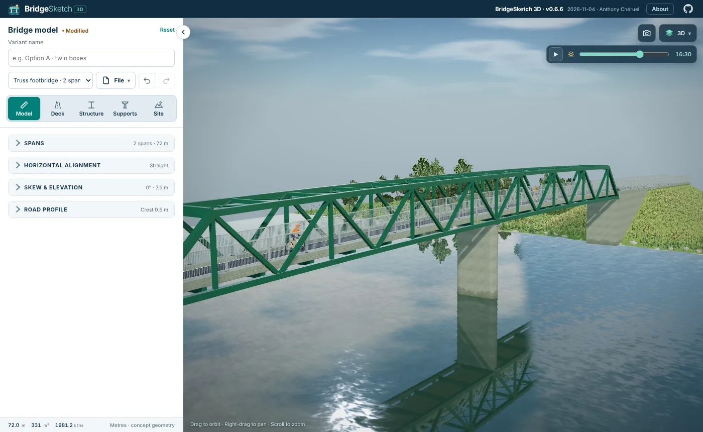
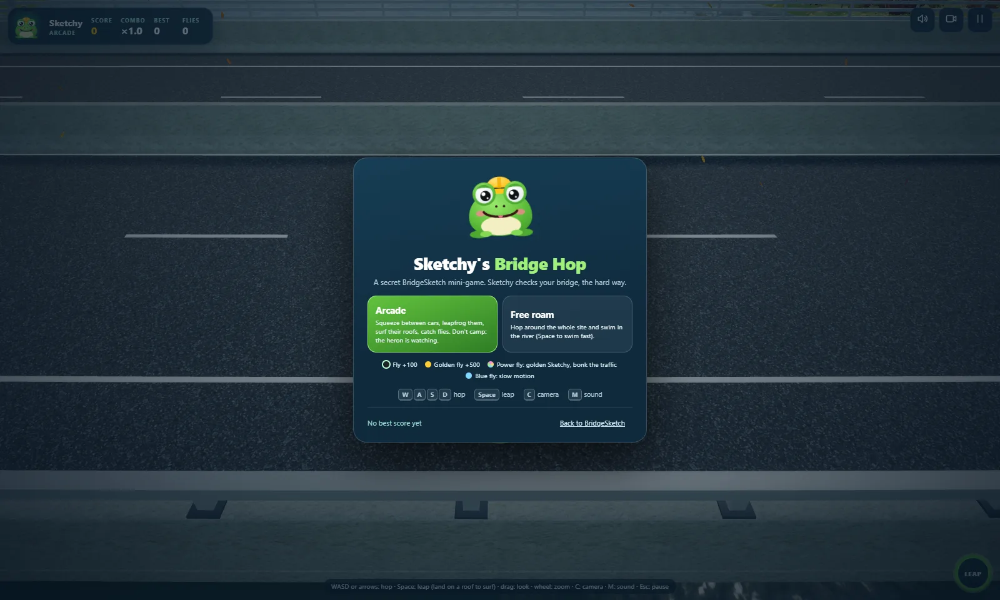

# BridgeSketch 3D

**Try it online:** [BridgeSketch 3D on GitHub Pages](https://acheruel.github.io/BridgeSketch-3D/)

**A quick visual tool for bridge concepts** · Version 0.6.7 · 6 November 2026 · Anthony Chéruel

BridgeSketch 3D is a browser-based, interactive 3D bridge configurator. Choose a span arrangement, deck, supports and site, then inspect the result from above, below or along the obstacle being crossed. It runs in the browser from static files, with no account, backend or build step.

## Features

- **Bridge systems:** steel plate girders, NEBT precast, steel and concrete boxes, solid slabs, frames, arches and steel truss footbridges.
- **Alignment:** curves, skew, crossfall and vertical profiles.
- **Supports:** wall, hammerhead, bent, portal and V piers, plus abutments.
- **Site:** rivers, roads, railways, open ground, terrain, weather and time of day.
- **Presentation:** bloom, sky, traffic and birds.
- **Parameters:** collapsible sections and formulas in numeric fields, such as `=12*3`.
- **History:** undo and redo with Ctrl+Z / Ctrl+Y.
- **Files and export:** save and open JSON, share link, PNG snapshot, GLB export and IFC export (2x3, 4, 4.3).

## What's new in 0.6.7

- **Cleaner defaults:** every example opens in Medium quality with the stylised gradient sky; the atmospheric haze option is gone (no more grey band at the horizon). Quality and season (spring/summer, autumn, winter) moved to the view menu, top right.
- **Steady wheel zoom:** the same 5 % step per notch on every mouse and browser, whatever the frame rate.
- **Messages** clear themselves within 10 s.
- **Steel girders:** adjustable cross-frame spacing (8 m by default). **Abutments** sit on 1.5 m footings; box-girder piers lose the small column plinth.
- **Trusses:** any height from 1.2 to 6 m for pony and through trusses, I-section floor beams, no knee braces on pony trusses.
- **IFC export** opens the free Online 3D Viewer (3dviewer.net) to drop the file in.

## What's new in 0.6.6

- **IFC export (File › Export IFC…):** every member becomes an IFC element with its class (beam, slab, wall, column, footing, railing, member, plate, bearing), a name, a material, a colour and a property set (role, span or support, chainage, paint), in the coordinates of the road profile. Three schemas: **IFC 2x3** opens as a project in Revit 2022, 2023 and 2026; **IFC 4** links into Revit and suits most viewers; **IFC 4.3** adds IfcBridge, its superstructure, abutment and pier parts, and IfcBearing. The geometry is faceted concept geometry, not parametric families.
- **Steel truss footbridges:** a new structural system for cyclist and pedestrian bridges, with the deck between the bottom chords. Pony (open top, knee braces) or through (top struts, X bracing, portal struts); Warren, Pratt or Howe web; post spacing, truss height and cross-beam spacing; simple or continuous spans, each truss ending with an inclined end post. New example: **Truss footbridge · 2 spans**.
- **Architectural formliner:** abutments can carry vertical ribs of varied widths, 40 mm proud, on the front wall, return or wing walls and girder screens (Supports › Abutments). On by default in the Fall river example.
- **Realistic vehicles:** new procedural cars, SUVs, pickups, vans, box trucks and long-nose tractors, with rounded bodies, real wheel arches, tinted glass, alloy wheels and light clusters, replacing the toy-like kit cars.
- **View menu:** weather (clear, rain, snow, leaves) and birds moved into the top-right menu, which now stays open while you choose; the time of day has its own bar below it.
- **Traffic:** a cyclist rides every sidewalk, and on two or more lanes in one direction the left lane runs a little faster.
- **Details:** bearing plinths have no chamfer on their bottom edges; the urban setting is shelved (files that used it open as rural).
- **Sketchy:** the lane-line hideout is closed (the heron watches it too), leaving a roof gives a few blinking frames of shield, and free roam gains a charged super jump (hold Space, up to 19 m: from the bank onto the deck), flight with a cape (F; Space up, Shift down) and an unstoppable frog who bonks every car and cyclist he meets and bounces off trains.

## What's new in 0.6.5

- **A clear view:** the 3D view and the parameters panel use the whole window, without a white frame. Views (3D, Plan, Elevation, Section), Drive, Focus, the time of day and the display switches (Reveal structure, traffic, Stats) share one drop-down in the top-right corner, next to the snapshot button. **Copy link** and **Export GLB** moved to the File menu; the model facts (length, deck area, triangles) sit at the foot of the parameters panel. The Fit button is gone.
- **GitHub:** a link to the repository in the top bar.
- **Fixes:** falling leaves, rain and snow no longer gather in one odd square in the Plan and Elevation views (they are off in those drawings); the time of day runs in the Fall river example.
- **Foldables:** the layout holds on an unfolded Galaxy Z Fold 8 in landscape (about 816 × 536 CSS px in Chrome) and on phones, with larger touch targets.
- **Sketchy:** meet the BridgeSketch mascot, a frog in a hard hat. He has a secret mini-game, *Sketchy's Bridge Hop*: open **About › Meet Sketchy** (or type `sketchy`, or add `?sketchy` to the address). Arcade: hop across the traffic with WASD on the bridge and its approaches, squeeze between two cars on a lane line, leap over them with Space, land on a roof to surf, catch flies. The power fly turns Sketchy gold for 5 s and bonks every vehicle he touches into the sky; the blue fly slows the traffic down. Don't camp on a sidewalk: the heron is watching. Free roam: hop anywhere on the site and swim in the river (hold Space to swim fast). Procedural music and sound (M to mute).

## What's new in 0.6.4

- **Sky:** a physical atmosphere (Rayleigh, Mie and ozone scattering, after Hillaire 2020) is the new default sky, with a real afterglow at dusk; the sun now sets behind the horizon. Stars and the Milky Way still come out at night.
- **River:** faster current mid-channel, the river bed seen through shallow water, and sun glints that widen with distance.
- **Interface:** the five parameter tabs have icons, the parameters panel collapses with the arrow on its edge, and the top bar is a third lower.
- **Views:** span lengths under the Elevation view; no author name on the Section drawing; Model info no longer shows the minimum clearance.
- **Defaults:** High quality, glow on, birds off. The first example is now **Fall river · 5 steel spans**.
- **Launch screen:** the bridge has the proportions of that example (1.4 m girders deepening to 2.4 m over 45 % of each span) and tapered pier caps.

## What's new in 0.6.3

- **Launch screen:** the bridge sketch is the loading bar: it fills in from left to right as the scene loads, and no longer slides off screen. The title's "3D" sits on the text line.
- **Road profile:** moved to **File › Road profile…**, with plan coordinates X, Y from a reference point and bearing at the west axis, so a curved alignment can be told from a straight one. The CSV gains X and Y columns.
- **Trees:** aspen foliage is green in summer (it kept its autumn yellow).
- **Hosting:** GitHub Pages is the main way to use the app; offline use is no longer a requirement.

## What's new in 0.6.2

- **Road profile:** chainage / elevation table with CSV export (chainage from the west abutment axis).
- **Trains:** full-size procedural freight, intercity and commuter trains.
- **Trees:** fuller crowns, denser groves and understory shrubs.
- **Fixes:** no cast shadows at night, flush abutment sides, columns meeting tapered caps, faster Reveal structure.

## What's new in 0.6.1

- **Interface:** QuickerBridge-style collapsible groups, formulas in numeric fields, a File menu with undo/redo, a modified marker and local autosave.
- **Vehicles and birds:** clear-coat paint, contact shadows and a realistic colour mix; gull-like birds with an on/off option.
- **Piers:** rounded, pointed or square wall ends; hammerheads with shaped shafts and heads; inclined-leg portal frames; V piers with or without a crosshead.
- **Rendering:** optional light bloom (**Glow**, off by default) in Balanced and High quality.
- **Concepts:** all seven examples revised with realistic span ratios and pier types.
- **Editing:** parameter changes no longer show the loading logo or recompile shaders, and grass is cached between edits.
- **Concrete:** cool grey (default) and warm pale grey; NEBT girders are fixed-depth only.

## Run it

- **Online:** open the [GitHub Pages demo](https://acheruel.github.io/BridgeSketch-3D/) in a modern desktop browser with WebGL 2.
- **Locally on Windows:** extract the archive, double-click `OPEN_OFFLINE.cmd`, keep its PowerShell window open and visit [http://127.0.0.1:5174/](http://127.0.0.1:5174/). Use the localhost address rather than opening `index.html` directly, because browsers block the module loading the app needs from `file://` URLs. GitHub Pages is the main way to use the app.
- **Self-hosting:** any static web server works; GitHub Pages serves this repository from its root (keep the empty `.nojekyll` file).
- **Sharing:** a link copied from a localhost session opens only where that local server runs; a Pages link opens anywhere.

## Controls

- Drag to orbit, right-drag to pan and scroll to zoom.
- Switch between **3D**, **Plan**, **Elevation** and **Section** views from the drop-down in the top-right corner. Section views can be saved as SVG.
- The **Time of day** slider covers 00:00–24:00, with golden hour around 19:00.
- Curated concepts sit at the top of the parameter panel. Choosing one resets every parameter.
- **Drive** travels along the road, railway or river beneath a middle span; **Escape** returns.

## Scope

BridgeSketch 3D produces concept and presentation geometry, not structural design.

## License

BridgeSketch 3D is released under the [MIT License](LICENSE) · © 2026 Anthony Chéruel. Third-party models, textures and libraries keep their own licences (CC0 or MIT), listed below.

## Credits and licences

- **Kenney** (CC0 1.0): [Train Kit](https://kenney.nl/assets/train-kit), [City Kit Suburban](https://kenney.nl/assets/city-kit-suburban) and [City Kit Commercial](https://kenney.nl/assets/city-kit-commercial). Vehicles up to 0.6.5 came from [Car Kit 3.1](https://kenney.nl/assets/car-kit); since 0.6.6 they are procedural.
- **Poly Haven** (CC0 1.0): rough concrete, asphalt, concrete wall and leafy grass textures.
- **Other CC0 textures:** river water from [Hazmat Harry](https://opengameart.org/content/seamless-water-tiles) and [qubodup](https://opengameart.org/content/3-live-proceduraly-generated-tiling-water-textures-512px-running-brushes) on OpenGameArt; bark from ambientCG.
- **MIT:** [Three.js](https://github.com/mrdoob/three.js); [EZ-Tree](https://github.com/dgreenheck/ez-tree) by Daniel Greenheck (tree generator, with `webgl-noise` by Ashima Arts); [CK42BB procedural stars](https://github.com/CK42BB/procedural-stars-threejs) and [procedural grass](https://github.com/CK42BB/procedural-grass-threejs); [Tw1ddle Sky-Shader](https://github.com/Tw1ddle/Sky-Shader) (physical sky); Steve245270533 three-stylized (grass shading ideas).
- Full credits and retained licences: [vehicle credits](models/VEHICLE_CREDITS.md), [train and building credits](models/SCENE_CREDITS.md), [texture credits](textures/CREDITS.md) and [generated texture notes](textures/GENERATED.md). Vendor notices are under `vendor/`.
